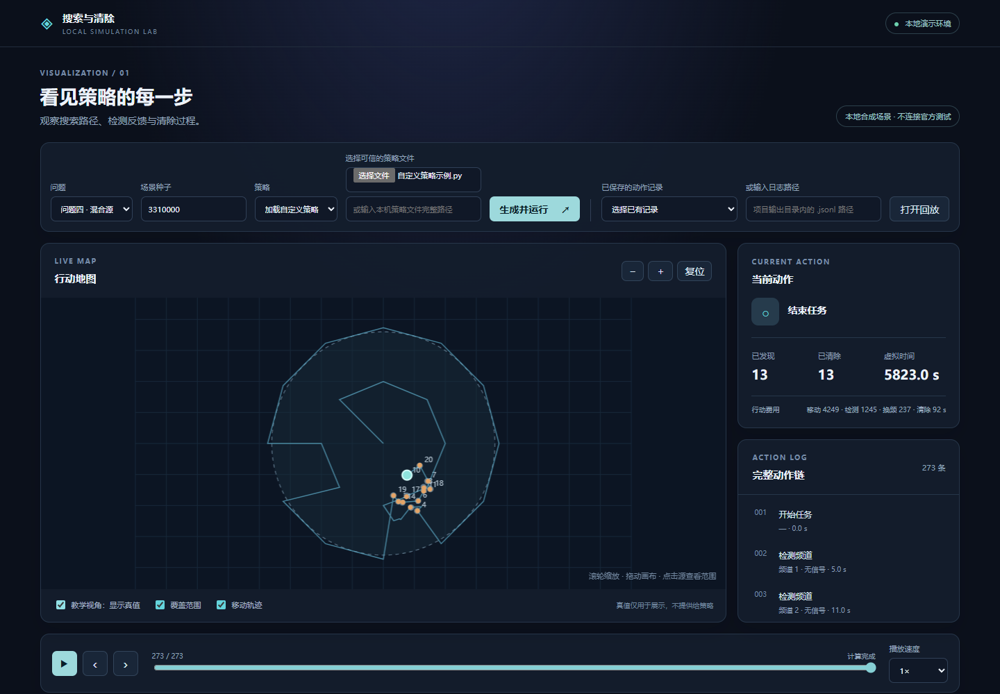

# 无线电干扰源搜索与清除：数学建模与可视化

本项目整理一次数学建模竞赛 B 题的求解过程：在测向误差有界、反馈有限的条件下，设计干扰源搜索、定位和清除策略。仓库包括四问最终算法、团队与 AI 协作的经验复盘、本地模拟与可视化演示，以及最终论文。



## 四问做了什么

| 问题 | 主要工作 |
| --- | --- |
| 一 | 将测向误差表示为半平面约束，求定位可行域及可靠清除条件。 |
| 二 | 利用首次接收信息设计第二检测点，并给出最坏定位误差的数值上下界。 |
| 三 | 用连续覆盖区域联合调度（CCR-JS）安排全向源的搜索、定位与清除。 |
| 四 | 用可见性证书和状态价值调度（VC-SVS）处理定向源盲区与光学后备。 |

从[题目分析](题目分析.md)了解模型主线，或阅读[最终论文](论文/B题论文_正式测试最终稿.pdf)。第三、四问的行动时间优化为启发式方法，有限测试不代表全局最优。

## 运行可视化演示

需要 Python 和 `requirements.txt` 中的依赖。在 Windows 上可双击 `可视化演示/启动演示.cmd`；也可在仓库根目录执行：

```powershell
python -m pip install -r requirements.txt
python 可视化演示/server.py
```

浏览器默认打开 `http://127.0.0.1:8765/`。选择第三问或第四问、输入随机种子，即可在本地合成场景中运行最终策略；地图展示路线、检测反馈和清除过程，右侧记录完整动作链。界面支持暂停播放、单步、变速以及教学真值视角；播放控制不会暂停后台策略计算。

也可选择自己的可信 Python 文件。策略需提供 `make_robot(backend, question)`，返回具有 `run()` 方法的对象，见[自定义策略示例](可视化演示/自定义策略示例.py)和[使用说明](可视化演示/使用说明.md)。自定义代码在本机直接运行，**只应加载可信文件**。

演示使用本地合成模拟器，不连接官方模拟器；其边界行为未证明与官方版本完全一致。本公开版附有一个标明“本地合成”的回放示例，不含官方模拟器和正式测试的原始动作日志。

## 结果与复盘

- 第三问：108 个冻结配对合成场景，案例平均由 251.19 降至 232.21 秒/源；98 例更快、10 例更慢。
- 第四问：522 个冻结合成场景，最终方案相对 round10 为 13 快、509 同；相对 round4 为 484 快、34 慢、4 同。
- 六次正式测试：第三问三例共清除 44 个源，第四问三例共清除 40 个源；案例平均分别为 215.54、450.14 秒/源。

不同随机案例不能直接用来归因策略提速；详见[测试结果总览](复现与总结/测试结果总览.md)、[协作复盘](复现与总结/从接题到交稿_协作复盘.md)、[典型案例](复现与总结/典型案例_从现象到决策.md)和[模型迭代记录](复现与总结/模型迭代记录.md)。

## 仓库结构

```text
最终代码策略/   四问策略及公共依赖；见目录内使用说明
可视化演示/     本地网页、服务端及自定义策略示例
src/benchmark.py  本地合成场景和模拟反馈
复现与总结/     协作过程、案例、轮次及结果口径
问题/           为理解关键决策精选的历史说明
论文/           最终论文 PDF
docs/           演示截图
```

本仓库为便于分享的精选版，不包含全部历史实验原始数据、官方模拟器安装包、加密日志、第三方文献全文和原题附件。历史说明中部分路径和旧版本状态仅作为过程记录；未随仓库提供的原始数据不能仅靠本仓库独立重算。最终代码由支撑包整理，原工作区、支撑包和论文展示版本的命名及少量日志字段存在差异，不应跨套混用。

本项目由团队完成，AI 用于辅助实现、测试和整理；方法选择与结果判断结合团队讨论进行。团队有权授权的项目代码采用 [MIT 许可证](LICENSE)；论文及未随仓库发布的第三方资料不因该代码许可证自动获得授权。
